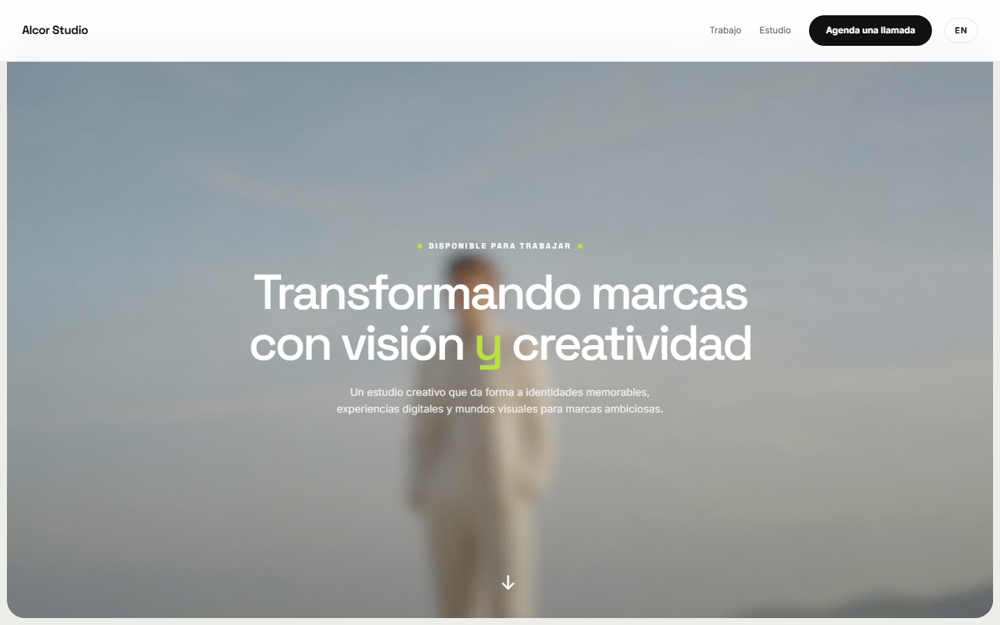

# Alcor Studio

A bilingual portfolio for a fictional creative studio, built as an original front-end with self-hosted imagery.



## What it is

A one-page portfolio for a fictional creative studio: a hero, services, testimonials, stats, selected work, a statement, and a contact section. The whole page is available in English and Spanish.

It is a presentation site, not a business application. There is no CMS, database or contact backend: enquiries open the visitor's email client, and the copy button writes the address to the clipboard.

## Why this over a portfolio template

- **Clean-room build.** Layout, copy, palette and imagery were written for this project; no template classes, stock photos, copy or names were carried over.
- **A non-software subject.** The portfolio belongs to a creative studio, with services and client work rather than a developer résumé.
- **Dynamic content.** The services section allows interaction, and the work items link to details.
- **Bilingual by default.** `/[locale]` routes, typed dictionaries, automatic browser-language detection, a manual switcher and `hreflang` alternates.
- **Static by default.** Both locales are prerendered. JavaScript is limited to interactive elements and the locale switcher.
- **Small dependency surface.** Next.js, React, Tailwind CSS and lucide icons. No UI kit, no animation library, no CMS client.

## Quick start

Requirements: Node.js 24 (see `.nvmrc`) and pnpm 11.

```bash
git clone https://github.com/JORDANROBERTO74/alcor-studio.git
cd alcor-studio
pnpm install
pnpm dev
```

Open `http://localhost:3000`. The proxy redirects to `/en` or `/es` based on your browser's `Accept-Language` and remembers an explicit choice in a cookie.

| Command | What it does |
| --- | --- |
| `pnpm dev` | Start the development server on port 3000 |
| `pnpm build` | Create an optimized production build |
| `pnpm start` | Serve the production build |
| `pnpm lint` | Run ESLint |
| `pnpm typecheck` | Run `tsc --noEmit` |

## Internationalization

- `src/i18n/config.ts` lists the supported locales and the default (`en`).
- `src/proxy.ts` detects the locale and redirects `/` to `/{locale}`.
- Copy lives in `src/i18n/dictionaries/en.ts` and `es.ts`; the English file defines the `Dictionary` type.
- Project details are localized; image paths are shared.
- Note dates are stored as ISO strings and formatted with `Intl.DateTimeFormat` in `src/lib/format.ts`.
- Every page declares canonical and `hreflang` alternates from `src/lib/seo.ts`.

## Imagery

- `public/assets/` contains self-hosted images used across the site.
- No stock photography, third-party logos or remote media remain in the project.

## Design

- **Palette.** Teal/linen/cobalt palette, with soft tints for selected and hover states. Tokens live in `src/app/globals.css`.
- **Type.** Archivo and Instrument Serif, self-hosted at build time through `next/font`.
- **Light only.** The interface declares `color-scheme: light` and has no dark variant, by design.
- **Form.** Clean lines, intentional spacing, and a focus on content.

## Accessibility and responsiveness

- Layouts were checked at desktop and mobile widths.
- Standard accessibility practices are followed.

## Project structure

```text
src/
  app/[locale]/          locale layout, page, not-found, Open Graph image
  components/            shared UI components (header, footer, buttons, etc.)
  config/                site identity and canonical URL
  i18n/                  locale config, dictionaries and loader
  lib/                   formatting, SEO helpers, i18n utilities
public/assets/           self-hosted images
docs/screenshot.webp
```

## Deployment

The app uses the default Vercel Next.js preset; no `vercel.json` is required.

1. Import the repository and keep the detected settings (`pnpm install`, `pnpm build`, output `.next`).
2. Set `NEXT_PUBLIC_SITE_URL` to the production origin.
3. Deploy, then verify `/{en,es}`, `/sitemap.xml`, `/robots.txt`, Open Graph image.

`NEXT_PUBLIC_SITE_URL` drives canonical links, `hreflang`, `sitemap.xml`, `robots.txt` and Open Graph URLs. When it is unset, the code falls back to `https://alcor-studio.vercel.app`; the public demo sets it to its Vercel origin.

Live demo: <https://alcor-studio.vercel.app>

## Status and scope

This is a portfolio reference implementation. Verification covers `pnpm lint`, `pnpm typecheck`, `pnpm build` and a browser pass in both locales at desktop and mobile widths.

## License

Proprietary, all rights reserved. See [LICENSE](LICENSE). Third-party dependencies remain under their own licenses.
